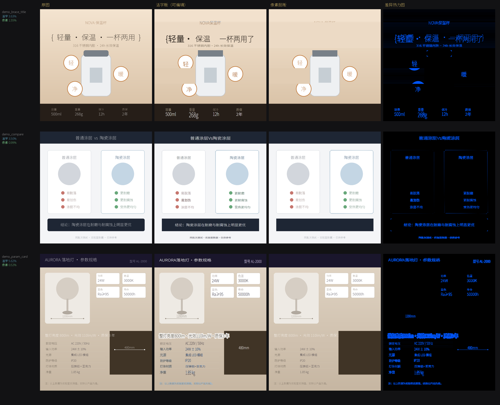

# layout-restore

**参考图 → 可编辑源件包（HTML + CSS + SVG），像素级可验收。**

> **English summary**
> Turn a reference image into an **editable** source package (HTML + CSS + SVG) —
> layered into *photo plate / vector structure / live text* — and verify it
> **pixel-by-pixel** against the original. Built for e-commerce main & secondary
> images (Taobao / Tmall / Amazon), but works on any poster-like layout.
> Ships with three **programmatically generated** sample images (no third-party
> assets), a single CLI, and a written-down set of hard-won rules.

---

## 为什么做这个

电商主图/附图里最贵的不是「做图」，是**改图**：改一次价、换一次图、调一次活动，
就得回到设计软件里重来一遍。

`layout-restore` 把一张参考图拆成**三层**，并把「三层」做成**可编辑的源码**：

| 层 | 是什么 | 可编辑性 |
|---|---|---|
| **L1 照片层** `plate.png` | 原图，挖掉待重建文字后修补 | 换图可改 |
| **L2 矢量结构层** `rects` / `lines` | 色块、表格线、标注线 | **改色/改宽都是改一个数** |
| **L3 文字层** SVG `<text>` | 正文、标题、参数、价格 | **活字** —— 直接改文案 |

产出不是一个 PNG，而是**一个能打开就改的源件包**：

```
out/<KEY>/deliver/<KEY>_源件包/
├── index.html        ← 唯一编辑入口（改价/改文案/换图都在这里）
├── index_px.html     ← 像素层版（字形用原图裁切，逐像素一致）
├── assets/
│   ├── plate.png     ← 照片层
│   ├── NotoSansSC-VF.ttf ...
│   └── px_t00.png    ← 降级成像素层的文字素材
├── _spec.json        ← 全部坐标 / 色值 / 字号 / 字重（机器可读）
└── 还原规格说明.md    ← 人类可读的元素表
```

---

## 效果（示例图全程序绘制，原创素材）



三张示例图的实测结果：

| 示例 | 版式族 | 活字版差异 | 像素层版 | PSNR |
|---|---|---|---|---|
| `demo_param_card` | 深色标题条 + 参数表 + **跨底色文字** | 5.11% | 5.11% | 21.59 |
| `demo_brace_title` | 大括号标题 + 圆形标注 + 底部信息条 | 3.64% | 3.64% | 20.62 |
| `demo_compare` | 左右双栏对比 + 结论文案条 | 3.53% | 3.53% | 21.47 |

**看热力图**（`examples/results/demo_param_card_热力图.png`）：
**非文字区是纯黑（0 差异）**，残差全部集中在文字上
—— 这说明**分层本身是干净的**，残差来自字体替代，是素材限制不是工程缺陷。

---

## 快速开始

```bash
git clone <this-repo>
cd layout-restore
pip install -r requirements.txt
python -m playwright install chromium     # 出图需要，只装一次

# ① 生成示例图（全部程序绘制，原创素材）
python examples/make_samples.py --out examples/samples

# ② 一条命令跑完整链
python -m layout_restore.cli build --src examples/samples/demo_param_card.png --key demo_param_card

# ③ 从**交付的源件包**重渲并对账（验的是客户拿到包后的效果）
python -m layout_restore.cli verify --pack out/demo_param_card

# ④ 看状态板 / 拼总览图
python -m layout_restore.cli status
python -m layout_restore.cli overview --out overview.png --packs out
```

装成命令（`pip install -e .`）之后直接用 `layout-restore ...`。

### 一次 `build` 做了什么

```
① probe_layers  参考图 → 文字层（坐标/色值/字号/字重）+ 色块 + 美术层
② autospec      探针 → spec 草稿（把量坐标的活儿自动化，人只做「审」）
③ vectorize     矢量结构层：色块 rects + 线条 lines
④ rebuild       渲染 → 逐属性寻优（字号/基线/x/字重/字色）→ 双版本 → 对比图 + 热力图
⑤ pixel_fallback  字体替代还原不出来的字 → 自动降级成像素层
⑥ verify        从交付源件包重渲，和原图对账
```

---

## 两种版本，各有用处

| 版本 | 文字 | 改文案 | 像素一致度 |
|---|---|---|---|
| **活字版** `index.html` | 真的 SVG `<text>` | ✅ 随便改 | 取决于字体是否可得 |
| **像素层版** `index_px.html` | 原图裁切的字形图 | ❌ | ✅ 逐像素一致 |

**字体替代是这个方法的天花板**：商业字体没有授权源，只能用可替代的公开字体
（Noto Sans SC / Noto Serif SC / Playfair Display / Century Gothic）。
字形不一样 → 残差全在文字上。所以要两个版本一起给。

---

## 验收指标

| 指标 | 含义 |
|---|---|
| `diff_gt20_pct` | 通道最大差 > 20 的像素占比（**主指标**，越小越好） |
| `mean_abs` | 平均绝对差 |
| `psnr` | 峰值信噪比 |
| **非文字区差异** | 排除所有文字框后的差异。**分层正确性的硬校验**，应为 `0.00%` |

> 不为 0 → 「哪些是素材、哪些是文字」判断错了。先查分层，再谈像素。

---

## 文档

| 文档 | 内容 |
|---|---|
| [docs/01_三层模型.md](docs/01_三层模型.md) | 分层骨架 + 每一层的可编辑性 |
| [docs/02_铁律.md](docs/02_铁律.md) | **踩坑换来的硬规则** —— 最有价值的部分 |
| [docs/03_版式族方法论.md](docs/03_版式族方法论.md) | 怎么把一张图变成「可复用的族配方」 |
| [docs/04_架构.md](docs/04_架构.md) | 代码结构 + 配置分层 + 扩展点 |
| [docs/05_快速开始.md](docs/05_快速开始.md) | 详细用法 + 常见问题 |

---

## 已知边界（说清楚比吹嘘有用）

1. **字体替代是天花板，不是分层逻辑的问题。**
   把主视觉换成原图裁切块后残差能掉到 0.4% —— 说明分层本身是干净的，残差来自字形。
2. **跨底色的文字（压在色块边界上）需要局部底色取样。**
   判「墨色」不能只用「离单一全局底色最远」—— 底色是**局部量**。
   详见 [docs/02_铁律.md](docs/02_铁律.md) 第 7 条。
3. **同族复用不能直接复制坐标。**
   同一个版式族的不同图，结构相同但坐标不同。族提供的是**判据与参数**，不是像素坐标。
4. **本仓库不含任何第三方素材。**
   三张示例图全部由 `examples/make_samples.py` 程序绘制，可复现、可商用。
   你自己的参考图请使用**你有权使用的素材**。

---

## 目录

```
layout_restore/
├── cli.py            ← 唯一入口（build/probe/autospec/vectorize/verify/overview/report/status）
├── config.py         ← 配置层（代码写「怎么判」，配置写「判什么·在哪」）
├── probe_layers.py   ← 分层探针（文字层 / 色块 / 美术层）
├── autospec.py       ← 探针 → spec
├── vectorize.py      ← 矢量结构层检测（rects / lines）
├── rebuild.py        ← 渲染 + 寻优 + 双版本 + 交付
├── pixel_fallback.py ← 像素层降级器
├── verify.py         ← 从交付源件包重渲并对账
├── overview.py       ← 总览对比图
├── report.py         ← 指标表
└── assets/           ← 字体（Git LFS）
examples/
├── make_samples.py   ← 程序生成示例图（原创素材）
└── samples/
docs/
skills/layout-restore/  ← Mavis Skill：把这套流程变成一条命令
tests/
```

---

## Skill：把这套流程变成一条命令

仓库自带一个 Mavis Skill（`skills/layout-restore/`），装上之后任何 session 里
说「复刻这批图 / 批量还原 / 还原成可编辑源件包」就能直接跑。

```powershell
# 安装（复制到 agent 的 skill 目录）
Copy-Item -Recurse skills\layout-restore "$env:USERPROFILE\.mavis\agents\mavis\skills\"

# 自检：环境齐不齐
python "$env:USERPROFILE\.mavis\agents\mavis\skills\layout-restore\scripts\doctor.py"

# 一键全流程：选片 → 批量复刻 → 验收 → 指标 → 对比网站
python "$env:USERPROFILE\.mavis\agents\mavis\skills\layout-restore\scripts\pipeline.py"
```

| 脚本 | 作用 |
|---|---|
| `doctor.py` | 环境自检（引擎 / chromium / OCR / 原图库 / 聚类产物逐项报） |
| `pick.py` | 选片（按**版式簇配额** + 簇内最远点采样，不让相似图稀释达标率） |
| `run_batch.py` | 批量复刻（并行 + 日志落文件 + 断点续跑） |
| `verify_all.py` | 全量验收（从**交付源件包**重渲并与原图对账） |
| `report.py` | 指标 + **三条口径**达标率 + 分簇分析 |
| `make_site.py` | 对比网站（原图｜还原图 横向并排 + 4× 放大） |
| `pipeline.py` | 一键串起全部 |

Skill 正文只有 108 行（lint 通过），bulky 的背景知识在 `references/`：
`铁律.md`（15 条踩坑换来的硬规则）、`三层模型与版式族.md`、`环境与依赖.md`。

详见 [`docs/06_工程化沉淀与Skill.md`](docs/06_工程化沉淀与Skill.md)。

---

## License

MIT —— 见 [LICENSE](LICENSE)。

字体均为 SIL Open Font License：
Noto Sans SC / Noto Serif SC（Google Fonts）、Playfair Display（Google Fonts）、
Century Gothic（GOTHIC.TTF，URW++ 衍生，AGPL/GPL+font-exception 另附）。
